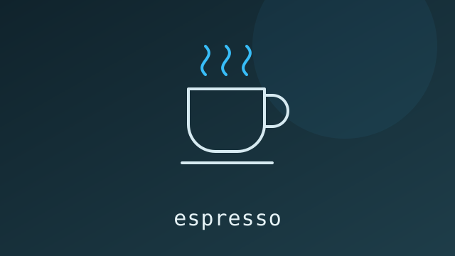

# espresso


An open source, stateless macOS zsh wrapper for caffeinate.

## Getting Started
Download the espresso script, then run these commands from the directory containing it:

```sh
mkdir -p ~/.local/bin
chmod +x espresso
mv espresso ~/.local/bin/
```

Ensure your `~/.zshrc` contains this line:

```sh
export PATH="$HOME/.local/bin:$PATH"
```

If it is missing, add it, then open a new terminal window or run `source ~/.zshrc`.

## Usage
espresso [-d|--display] [hours minutes | stop | status]

* **Timed Prevention**: "espresso 2 30" prevents system sleep for 2 hours and 30 minutes. If duration arguments are completely omitted, the script asks for both values in one prompt: `Enter duration (hours minutes): `. Enter `2 30` for 2 hours and 30 minutes. If only hours are supplied (e.g., `espresso 2`), minutes default to zero.
* **Display Control**: Add "-d" or "--display" (e.g., "espresso -d 1 0") to force the display monitor to remain powered on alongside the system background processes.
* **espresso status**: Audits the system to verify whether an active user-owned sleep prevention process is running.
* **espresso stop**: Stops all `caffeinate` processes owned by your user, including those started outside Espresso.
* **Constraints**: The script actively blocks execution and errors out if another "caffeinate" process is already running under the active user account.
